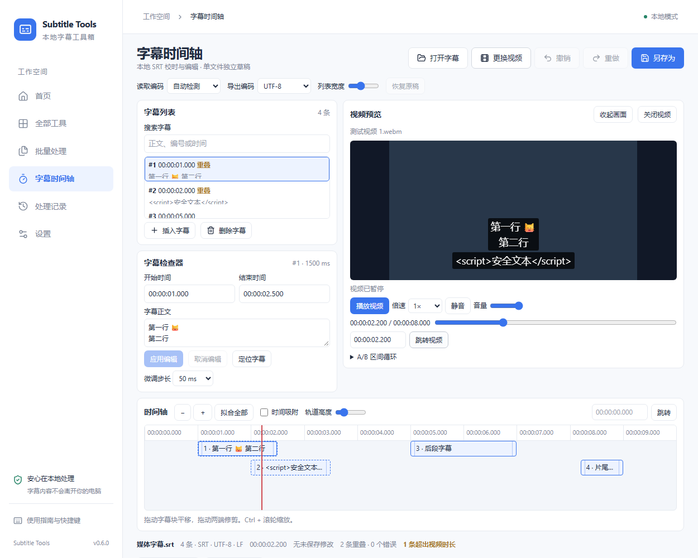

# v0.6.0 时间轴与本地视频验收

## 测试环境

Windows 11 Pro 25H2 x64（26200.9711），Edge WebView2 156.0.4314.58，Node 24.16.0，npm 12.0.1，Rust 1.97.0 MSVC，Tauri Rust 2.12.5 / CLI 2.12.4。原生脚本使用 Windows PowerShell 5.1 与 UI Automation，浏览器回归使用 Playwright Chromium。

## 媒体样本和重现

`scripts/generate-media-fixture.mjs` 生成 320×180、30 fps、8 秒的纯色样本。Windows 使用 H.264 Baseline 和 48 kHz、48 kbps AAC 正弦音，MP4 启用 faststart。Chromium 用 VP8 WebM，浏览器测试模拟 IPC 与 Range 响应，使用真实 HTML 视频解码。FFmpeg 只在测试主机生成素材，安装器和便携版使用系统 WebView2。

```powershell
npm ci
npm run check:versions
npm run test:e2e -- e2e/media-preview.spec.ts
cargo test --locked --manifest-path src-tauri/Cargo.toml commands::media::tests
npm run release:win -- --check
npm run release:win
npm run release:verify
npm run disk:report
```

正式流程在 ZIP 解压 EXE 和 Setup 安装后的 EXE 上分别运行 `windows-smoke.ps1 -Scenario workflow -ExpectedVersion 0.6.0`。仅重跑媒体场景时可传 `-Scenario media`，并传入绝对 `-ExePath` 和 `-ReportPath`。驱动以独立临时配置启动实际应用，结束后校验源文件哈希并恢复设置。Windows 构建、安装和验收需要已登录桌面。

## 检查范围

| 检查 | 验证方式 |
| --- | --- |
| 同步与草稿 | Chromium 检查起点含、末端开、间隙、重叠、文本安全、实际播放与定位。Windows 验证 0.4 / 2.2 / 4 / 5 / 7.6 秒跳转及 8 秒结束，草稿与导出继续有效。 |
| 播放控制与 A/B | 原生 UI Automation 操作播放、暂停、音量、静音、倍速，验证实际时间经过 B 前回到 A，清除后继续越过 B。Vitest 另覆盖缓冲、播放拒绝、连续 seek、到达媒体末尾后的循环。 |
| 异常与生命周期 | 检查取消选择、损坏文件、人为占用、源句柄锁定和释放、替换与重开。原生 Rust 回归覆盖 junction 祖先、UNC/设备路径、非法 URI、未授权、过期令牌和读取边界。 |
| 兼容性 | MP4 H.264/AAC 是本次正式包主验收。VP8/Opus WebM、无音轨 MP4、H.264/AAC MOV/MKV、HEVC/AAC MP4 各一个样本在同一运行时的技术实验通过。结果限于该编码、容器与环境。 |
| 体积与资源 | 280,707,222 字节视频的实际原生 Range、内存和撤销证据见 [Gate 4](MEDIA_ACCESS_SPIKE.md)。最终包保持现有运行时文件白名单。 |

10000 条字幕、900×620 窗口、收起画面后，正式门槛中的 Chromium 在 1.25 秒内采集 76 次动画帧间隔，P95 16.8 ms，长任务 0，字幕列表与检查器 DOM 变动 0。光标继续推进，播放、展开画面和另存可到达。此结果来自本机单次采样，反映前端工作区在该负载下的表现。

| 时间轴条目 | 打开至可操作 ms | 缩放与滚动 ms | 实际拖动与核对 ms | 拟合/缩放后块数 | 列表行 | 采样 JS 堆字节 |
| ---: | ---: | ---: | ---: | ---: | --- | ---: | ---: |
| 500 | 290.46 | 141.20 | 293.91 | 27 / 27 | 8 | 34,158,448 |
| 5,000 | 282.10 | 148.57 | 298.12 | 27 / 27 | 8 | 42,750,656 |
| 10,000 | 294.13 | 153.22 | 283.80 | 27 / 27 | 8 | 69,465,756 |

`npm run benchmark` 首测、隔离复测均通过。50,000 条三步通用流程的中位数，Node 为 556.72 / 541.13 ms，Chromium Worker 为 786.50 / 783.50 ms。0.5.0 上轮记录为 295.94 / 455.90 ms，本轮对比确认通用引擎、Worker 和基准脚本源码无差异，耗时差异的原因仍待进一步控制变量定位。两次 Worker 均创建/终止 1,017 / 1,017，活动数 0。日志见 `src-tauri/target/media-v060-benchmark.log` 和 `media-v060-benchmark-isolated.log`，结构化结果在 `src-tauri/target/benchmark/`。



## 正式产物与回执

2026-11-06 在干净提交 `f237b5c8d97ce42cddc0042f00ef9fc9fde176a4` 构建，源码指纹为 `B1C5BA01090D359EC6FA3611AD88429930D54049AE2998D8350DDC4F6A690174`。同一提交通过 GitHub Chromium 和 Windows（Rust 1.99.1）CI。[构建提交 CI](https://github.com/DewMysimple/SRTTools/actions/runs/42181141076)

`npm ci`、版本同步、lint、typecheck、前端 build、332 Vitest、81 Chromium、46 Cargo、Clippy、19 项发布安全测试、22 个 PS5.1 脚本解析、10 项 Windows QA 安全测试和 12 项状态恢复测试通过。便携 ZIP 解压版和实际安装 EXE 各通过 10 项旧工作流、7 项时间轴与 7 项媒体检查，Setup 另通过 19 项安装、卸载和恢复检查。实际安装 EXE SHA-256 为 `C1BED742607F8EFD7D1588DC442C7A151FC6553E62DD0291FEAA7BC93D31076D`。

ZIP 与 Setup 的原生媒体样本均为 61,433 字节，SHA-256 为 `4E9ABDDB12FA4E879728459454BC54E8C80D819E39E54EF6A639DBF65C27B3FA`。FFmpeg 为 `n8.0.1-23-gf9a3e1b776-20251204`。回执时刻分别为 `07:33:00Z` 与 `07:33:41Z`。Windows 原生流程实测源视频与 SRT 字节保留、重复切换和释放。

前两轮正式打包分别在 ZIP 与安装版遇到旧工作流的下拉选择失败，v0.5.0 保持可验。改用受控桌面输入并核对提交后的值，原 Setup 重试及最终新包均通过。媒体选择器取消后的重开竞争已加禁用状态与浏览器回归。新 Rust CI 对 `fetch_update` 的弃用由兼容最低版本的原子比较交换处理。失败摘要留在 `src-tauri/target/media-v060-first-release-failure.json`、`media-v060-native-workflow-retry.json` 和 `media-v060-second-release-failure.json`。

| `release-output/` 文件 | 字节 | SHA-256 |
| --- | ---: | --- |
| `SRTTools-Setup.exe` | 2,123,315 | `EB6A2BE94B15E1362C42C3591504668B3ECC6ECA278BDB23053CFE50C5E03081` |
| `SRTTools.zip` | 2,446,581 | `BC1DAB0C62A9F50D6698F593D7E8C4784C9DC4B8D7DF69447F821681741B91A7` |
| `SRTTools/subtitle-tools.exe` | 4,534,784 | `B7690B8743780B063708BDEC40236D5F9617CA7DB91AC633977E7C1C9BF87F94` |
| `SRTTools/THIRD_PARTY_NOTICES.txt` | 728,050 | `A17EA3B35FF06CEC85022E4034F85F2061505E68D5D18306B2B1EC0B257E7780` |
| `build-info.json` | 7,724 | `C26807319675740B7D04B599FA52D9508A154E9DBA801EB3D58379761D8BDFB8` |
| `SHA256SUMS.txt` | 439 | `AABF22B56AF92FC65977991DC258DDE9EBA685233E3C4A55D484942B9D96753C` |

六个文件总计 9,840,893 字节。正式候选已通过 `npm run release:verify`，源码和包体库存复核结果见本机 `src-tauri/target/media-v060-release-verify.log`。

`npm run disk:report` 发布前后分别记录 `release-output/` 为六件 9,748,488 与 9,840,893 字节。发布事务清理了已验证的 NSIS 中间件和暂存。另按样本库存核对 13 个本轮合成媒体与实验包副本后清理，共 294,083,087 字节，保留回执、素材参数和哈希。Rust debug 缓存由 19,543,071,083 增至 20,140,900,398 字节，包含本轮重新编译的依赖和应用测试；按项目默认保留。既有未知暂存目录保持受保护。

## 兼容与验证边界

Windows 10、全新 WebView2 安装、实际系统休眠恢复、125%/150%/200% 系统 DPI、受限用户真实目录、映射网络盘及 Windows 原生长路径选择器为 NOT RUN。技术实验覆盖中文、空格、`#` 与 emoji 文件名，正式包延续同一安全协议。本轮发布仅限项目固定本地产物，项目许可证由用户留待公开发布前决定。
